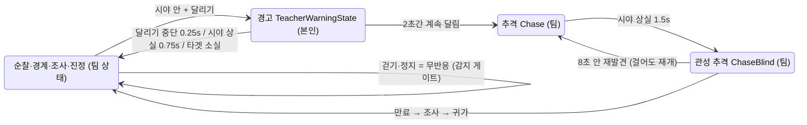
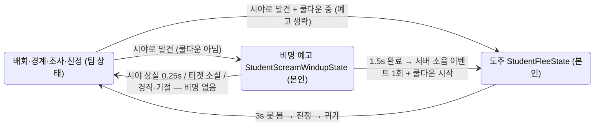

# EmptyHouse Game Development — 신규 좀비 2종(선생님·학생) 개인 작업 아카이브

## 프로젝트 및 구현 범위

본 프로젝트는 SW마에스트로 17기 팀 프로젝트 **Empty House**에서 개발한 신규 좀비 AI 2종(Teacher, Student)의 기획·설계·구현·검증 과정을 정리한 기술 포트폴리오입니다.

기존 팀의 좀비 AI 프레임워크를 기반으로 종별 행동 로직과 상태 전이를 설계하고, Claude Code를 활용해 구현한 뒤 자동 테스트와 Unity 플레이 테스트로 검증했습니다.

- **`src/`** — 종별 AI 구현 및 공통 시스템 연동 코드
- **`tests/`** — 행동 규칙과 Unity 프리팹 검증 테스트
- **`assets/`** — 신규 좀비 프리팹 및 설정 에셋
- **`docs/`** — 기획, 시스템 설계, 구현 과정, 검증 결과

이 저장소는 포트폴리오용 코드 아카이브이며, 전체 게임을 실행할 수 있는 독립 Unity 프로젝트는 아닙니다. Walker 모델·애니메이션, 이벤트 채널·설정 에셋, 나머지 팀 코드가 포함되어 있지 않아 이 저장소만으로는 빌드·실행·프리팹 열기가 되지 않습니다(아래 「포함하지 않은 것」).

> 기준일 2026-11-23

## 한눈에 보기
| 항목 | 결과 |
|---|---|
| 기획 · 핵심 행동 구현 | **Teacher·Student 완료** — 종별 Controller·State·Profile·순수 규칙, 독립 프리팹, NetworkPrefab 등록 |
| Unity 컴파일 | **오류 0** (Teacher 커밋 단독 상태 · 최종 상태 각각) |
| 신규 자동 테스트 | **38/38 통과** (Teacher 22 · Student 16) |
| 전체 EditMode | **294개 중 291 통과 · 기존 실패 2 · 건너뜀 1** — 실패·건너뜀은 변경 전 기준선과 동일한 팀 기존 테스트 |
| 실제 플레이 | Teacher 핵심 행동 확인 · Student 비명·도주·쿨다운 로그 확인 (호스트 1인) |
| 전용 외형·모션 | **FBX 생성 완료** — 캐릭터 2종, 동작 FBX 20편(영상 22편 사용/23회 시도, 약 1일, 영상 생성 비용 약 $35 추정) · **Unity 적용** — 작업 브랜치 로컬에 외형·대표 동작 연결과 자동 검증 완료, 팀 저장소 미반영 · 새 외형으로 실제 플레이 미실행 → [06](docs/06_CHARACTER_PIPELINE.md) |
| 미완료 | 새 외형 플레이 검증, 2인 검증, 정식 게임 통합(팀 반영·맵 스폰 목록·도감 텍스트 등), 게임플레이 영상·Inspector 캡처 |

## 저장소 구성
```
src/
  Teacher/      본인 신규 — Teacher 컨트롤러·상태·프로파일·규칙
  Student/      본인 신규 — Student 컨트롤러·상태·프로파일·규칙
  Shared/       본인 신규 — 두 종 공용 순수 규칙(포효 중단) + 규칙 어셈블리 정의
  TeamSystems/  팀 공통 시스템(참고용) — 종별 코드가 상속·호출하는 파일만 선별, 일부는 본인이 몇 줄 추가
                OWN_CHANGES.diff = 팀 공통 파일에 대한 본인 변경분 전체
tests/
  Rules/        순수 규칙 EditMode 테스트(26개) + 테스트 어셈블리 정의
  Editor/       실제 프리팹·애니메이터 검증 EditMode 테스트(12개)
assets/
  Prefabs/      Zombie_Teacher / Zombie_Student 프리팹(+.meta)
  Profiles/     SO_Zombie_Teacher / SO_Zombie_Student 프로파일(+.meta)
  DEPENDENCIES.md  프리팹·프로파일이 참조하는 GUID와 미포함 이유
docs/           01 기획 · 02 레벨(미착수) · 03 구현 기록 · 04 테스트 결과 · 05 포트폴리오 구성안
SOURCES.md      모든 파일의 원래 Unity 경로 · 구분(본인/팀) · 크기 · 해시
```
- 모든 파일은 팀 Unity 프로젝트의 원본을 **수정 없이** 가져왔다. 원래 경로와 구분은 [SOURCES.md](SOURCES.md).
- 순수 규칙(`*Rules.cs`)과 그 테스트만 Unity·팀 타입에 의존하지 않는다. 나머지는 팀 공통 시스템(`src/TeamSystems`)과 Unity·Netcode 를 전제로 한다.

---

## 선생님(Teacher) — "달리면 걸린다"

### 기획 의도
플레이어의 기본 생존 수단인 **달리기에 비용**을 붙인다. 평소에는 걷는 플레이어를 무시하고, 시야 안에서 달리는 플레이어만 적발해 경고한다. 경고를 무시하면 추격한다.

### 행동 규칙
| 상황 | 반응 |
|---|---|
| 시야 안에서 걷기·웅크림·정지 | 무반응 |
| 시야 안에서 달리기 | 제자리 정지 + 경고(포효 연출) 2초 |
| 경고 중 달리기 중단 0.25초 / 시야 상실 0.75초 / 타겟 소실 | 경고 취소 → 타겟·래치·위협 음악 해제 → 순찰, 포효 즉시 중단 |
| 경고를 무시하고 2초간 달림 | 추격 |
| 추격 시작 후 | 걸어도 즉시 해제하지 않음 — 팀 기존 추격·관성 추격 규칙(시야 상실 1.5초 → 관성 추격 8초 → 조사 → 귀가) |

### 상태 전이


### 구현 파일
| 파일 | 역할 |
|---|---|
| [`src/Teacher/ZombieControllerTeacher.cs`](src/Teacher/ZombieControllerTeacher.cs) | 팀 `ZombieController` 상속. 감지 기여 훅에서 추격 전 단계에만 "시야 안 + 달리기" 게이트 적용, 상태 교체 훅에서 `RoarTransition` → 경고, 경고 취소(`ServerCalmDown`), 포효 중단 옵트인 |
| [`src/Teacher/TeacherStates.cs`](src/Teacher/TeacherStates.cs) | `TeacherWarningState` — 매 서버 틱 규칙 판정 결과를 추격/취소 전이로 옮김, 분석용 로그(`t=`·경과·달리기 중단 시간) |
| [`src/Teacher/TeacherProfileSO.cs`](src/Teacher/TeacherProfileSO.cs) | 경고 2s · 달리기 중단 유예 0.25s · 시야 상실 유예 0.75s |
| [`src/Teacher/TeacherWarningRules.cs`](src/Teacher/TeacherWarningRules.cs) | 감지 게이트·경고 판정 순수 규칙 — 우선순위 타겟 소실 → 달리기 중단 → 시야 상실 → 만료(같은 틱이면 취소 우선) |
| [`src/Shared/RoarInterruptRules.cs`](src/Shared/RoarInterruptRules.cs) | 취소(→순찰)일 때만 포효를 끊는 판정 — 경고→추격·기존 종은 종전대로 |

---

## 학생(Student) — "들키면 시끄러워진다"

### 기획 의도
직접 공격하지 않는 대신 **비명으로 주변 좀비를 불러 상황을 악화**시킨다. 예고 중 시야를 끊거나 기절시키면 비명을 막을 수 있는 대응 창을 준다.

### 행동 규칙
| 상황 | 반응 |
|---|---|
| 평소 | 스폰 지점(교실) 주변 배회 |
| 시야로 플레이어 발견 | 즉시 비명 예고(제자리 정지 + 예고 연출) 1.5초 |
| 예고 중 시야 상실 0.25초 / 타겟 소실 / 경직·기절 | 비명 취소 → 배회, 포효 즉시 중단 |
| 예고 완료 | 서버가 **비명 소음 이벤트 1회** 발행(80dB) → 주변 좀비가 기존 청각으로 위치 조사 |
| 비명 직후 | 플레이어 반대 방향으로 도주 → 3초간 못 보면 진정 → 귀가 |
| 쿨다운 20초 중 재발견 | 비명 없이 바로 도주 |

### 상태 전이


### 구현 파일
| 파일 | 역할 |
|---|---|
| [`src/Student/ZombieControllerStudent.cs`](src/Student/ZombieControllerStudent.cs) | 팀 `ZombieController` 상속. 발견 즉시 발각, 쿨다운 중이면 상태 머신으로 즉시 도주, `RoarTransition` → 예고 · `Flee` → 도주 교체, `ServerEmitScream`(서버 소음 1회 + 쿨다운), 취소·위협 망각 |
| [`src/Student/StudentStates.cs`](src/Student/StudentStates.cs) | `StudentScreamWindupState`(예고 판정 → 비명/취소) · `StudentFleeState`(위협 반대 방향 지점 선정·재선정·포기 — Oiler 도주를 참고한 독립 구현) |
| [`src/Student/StudentProfileSO.cs`](src/Student/StudentProfileSO.cs) | 예고 1.5s · 유예 0.25s · 비명 80dB · 쿨다운 20s · 도주 3m/s · 6m · 1s · 3s · 8방향 |
| [`src/Student/StudentScreamRules.cs`](src/Student/StudentScreamRules.cs) | 예고 판정(비명 1회 보장)·쿨다운·도주 후보 방향·점수·포기 순수 규칙 |

---

## 기존 공통 시스템을 재사용·확장한 방법
- **상속 + 확장 훅만 재정의**: 두 종 모두 팀 `ZombieController`([참고](src/TeamSystems/Zombie/ZombieController.cs))를 상속하고, 팀이 열어 둔 두 확장 지점만 사용한다 — 감지 기여 훅(`ServerContributePerception`, 지각 조립체 [`ZombiePerceptionBuilder`](src/TeamSystems/Zombie/ZombiePerceptionBuilder.cs) 수정)과 상태 교체 훅(`TryCreateSpeciesState`, 상태 머신 [`ZombieStateMachine`](src/TeamSystems/Zombie/ZombieStateMachine.cs)이 우선 조회).
- **새 상태 종류 없이 교체**: 경고·예고는 기존 발각 전환(`RoarTransition`) 자리, 도주는 기존 `Flee` 자리를 종별 상태로 교체 — 복제되는 상태 종류를 늘리지 않았다.
- **팀 공통 파일 변경은 추가만**([OWN_CHANGES.diff](src/TeamSystems/OWN_CHANGES.diff)): 종 열거형 2값 · 감지 인터페이스 `IsSprinting` · 포효 중단 옵트인 속성(기본 false)과 애니메이터 처리 · 상태 머신 `protected` 접근자. 기존 6종 동작 불변은 테스트로 확인.

## 서버 소음 이벤트와 네트워크 처리
- **서버 권위**: 감지·판정·전이·비명 발행은 서버(호스트)에서만 돈다. 새 NetworkVariable·RPC **0개**.
- **연출 복제**: 경고·예고는 이미 복제되는 `RoarTransition` 상태를 재사용 → 클라이언트가 기존 경로로 포효 애니메이션·음성 재생. 포효 중단은 각 클라이언트가 복제 상태 에지와 종 고정 속성으로 같은 판단을 한다.
- **달리기 판정(Teacher)**: 플레이어의 달리기 값(오너 권위 NetworkVariable)을 서버에서 읽는다 — [`ZombiePerceptionSource`](src/TeamSystems/Zombie/ZombiePerceptionSource.cs).
- **비명(Student)**: 서버가 [소음 발행 채널](src/TeamSystems/NoiseSystem/NoiseEmittedEventChannelSO.cs)에 단발 이벤트([`NoiseEmittedEvent`](src/TeamSystems/NoiseSystem/NoiseEvents.cs))를 1회 발행 → 팀 [`NoisePropagationSystem`](src/TeamSystems/NoiseSystem/NoisePropagationSystem.cs)이 거리 감쇠(1.5dB/m)·벽 차폐(60dB)·좀비별 가청 판정 → 주변 좀비가 기존 청각으로 위치를 조사(소음원이 플레이어가 아니라 타겟은 잡지 않음). 쿨다운 시각은 서버 메모리에만 있다.
- **프리팹**: NetworkPrefab 등록, 네트워크 식별 해시 고유(Teacher 704143739 · Student 3895826500 — 파일 값 확인).

## 테스트와 검증
| 구분 | 결과 | 코드 |
|---|---|---|
| Teacher 경고 규칙 | 9/9 | [`tests/Rules/TeacherWarningRulesTests.cs`](tests/Rules/TeacherWarningRulesTests.cs) |
| 포효 중단 규칙 | 5/5 | [`tests/Rules/RoarInterruptRulesTests.cs`](tests/Rules/RoarInterruptRulesTests.cs) |
| Teacher 실제 프리팹·애니메이터 | 8/8 | [`tests/Editor/TeacherRoarInterruptTests.cs`](tests/Editor/TeacherRoarInterruptTests.cs) |
| Student 비명·도주 규칙 | 12/12 | [`tests/Rules/StudentScreamRulesTests.cs`](tests/Rules/StudentScreamRulesTests.cs) |
| Student 실제 프리팹·등록 | 4/4 | [`tests/Editor/StudentPrefabTests.cs`](tests/Editor/StudentPrefabTests.cs) |
| **신규 합계** | **38/38** | |
| 전체 EditMode | 294개 중 291 통과 · 기존 실패 2 · 건너뜀 1 (기준선 동일) | [04](docs/04_TEST_RESULTS.md) |

**실제 플레이(에디터 호스트 1인, Editor.log 분석)**
- Teacher: 경고 7회 → 달리기 중단 취소 5 · 2초 후 추격 2(경과 2.02s · 2.03s) · 추격 중 걷기 시 추격 유지 · 관성 추격 후 귀가.
- Student: 예고 72 = 완료 61 + 시야 상실 취소 11 · 비명 61회(중복 0) · 비명 후 도주 61 · 쿨다운 중 비명 없이 도주 101 · 위협 상실 후 진정 159(귀가 완료 34).
- 주변 Walker 반응: 학생 2마리 동시 비명 직후 0~3.19초 안에 Walker 12마리가 조사로 전환 — **강한 정황 증거, 감지 로그가 없어 직접 인과는 미확정**.

**미검증**: 2인(클라이언트) 연출 · Teacher 경고 연출 시각 식별 · 0.25초 유예 정량 · 경고 중 시야 상실 취소 · 포효 중단 화면 확인 · Student 예고 중 경직·기절 취소.

## 팀 공통 시스템 vs 본인 구현
| 팀 공통 시스템 (팀 작성 — `src/TeamSystems` 는 참고용) | 본인 구현 (`src/Teacher` · `src/Student` · `src/Shared` · `tests` · `assets`) |
|---|---|
| 좀비 컨트롤러·상태 머신·의심도, 시각·청각 감지 수집, 공통 상태(배회·조사·추격·관성 추격·진정), 소음 전파·가청 판정, 무리 동조, 서버 권위 복제, 맵 생성 스폰, Walker 모델·애니메이션 | 두 종 기획·수치, 감지 게이트, 경고·예고·도주 상태와 순수 규칙, 비명 소음 발행·쿨다운, 포효 중단 옵트인, 팀 공통 파일의 소규모 확장(OWN_CHANGES.diff), 프리팹·프로파일 구성·등록, 신규 테스트 38개, 플레이 로그 분석 |

## 포함하지 않은 것
- **Walker 모델·메시·애니메이션·머티리얼**(약 137MB): 용량 때문에 제외 — [assets/DEPENDENCIES.md](assets/DEPENDENCIES.md). `assets/` 의 두 프리팹은 팀 커밋 시점 버전이라 **Walker 외형을 임시로 쓰는 상태**다. 전용 외형·모션은 별도로 제작했고 작업 브랜치에서 연결했지만 팀 저장소에는 아직 반영하지 않았다 — [06](docs/06_CHARACTER_PIPELINE.md), 이미지 [`media/`](media).
- 이벤트 채널·설정 ScriptableObject, 나머지 팀 코드(플레이어·오디오·UI·다른 종 등), Unity 프로젝트 설정·패키지, 맵 스폰 목록 변경(팀 미반영).
- 공개 범위: 저장소 소유자가 팀에 확인한 범위(2026-11-23) 안에서 비공개 저장소에 보관한다. 승인 기록 위치: _(기입 필요)_. 제3자 에셋은 팀 승인과 별개라 포함하지 않는다.

## 문서
| 문서 | 내용 |
|---|---|
| [01_ZOMBIE_DESIGN](docs/01_ZOMBIE_DESIGN.md) | 두 종 기획 — 행동 규칙, 수치, 설계 판단, 상태 전이·취소 조건 |
| [02_LEVEL_DESIGN](docs/02_LEVEL_DESIGN.md) | 신규 방 — 미착수(후순위) |
| [03_IMPLEMENTATION](docs/03_IMPLEMENTATION.md) | 작업별 구현 기록 + 부록(클래스 구조·네트워크·예외 처리) |
| [04_TEST_RESULTS](docs/04_TEST_RESULTS.md) | 자동 테스트·플레이 로그 검증 결과와 미검증 항목 |
| [05_PORTFOLIO_PAGE_PLAN](docs/05_PORTFOLIO_PAGE_PLAN.md) | 지원용 포트폴리오 2장 구성안 |
| [06_CHARACTER_PIPELINE](docs/06_CHARACTER_PIPELINE.md) | 신규 캐릭터 제작 파이프라인 결과와 Unity 적용·검증 범위, 실제 산출물 이미지 |
