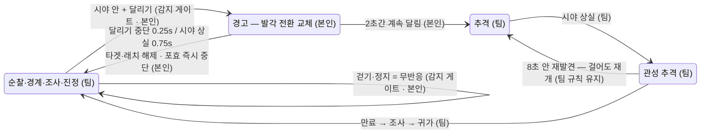
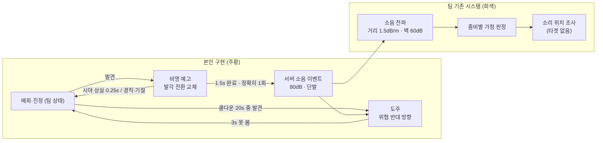

# 05. 지원용 포트폴리오 — 신규 좀비 2종 구현 페이지 (2장) 최종 구성안

> 상태: 구성 확정 · 캡처·영상 미확보 · 코드 발췌는 팀 공개 승인 전까지 의사코드로 대체 (README "코드 공개 검토" 참고)

> 용도: 넷마블네오 지원 포트폴리오(PDF)에 넣을 2장. 수치는 2026-11-23 기준 실제 결과다. **미검증·미구현 항목은 페이지에도 그대로 표기**한다.
> 공개 조건: 팀 저장소(비공개)의 코드·에셋·캡처는 **팀 공개 범위 확정 후**에만 넣는다. 확정 전에는 코드 발췌 → 의사코드, 캡처 → 다이어그램(각 칸에 대체안 표기).
> 표기 원칙: **팀 기존 시스템 = 회색 / 본인 구현 = 주황.** "완료"는 자동 테스트나 플레이 로그로 확인된 것만 쓴다.

## 공통 헤더 (두 장 상단 동일)
- 제목: **신규 좀비 2종 — 공통 좀비 AI 위에 종별 규칙을 얹다**
- 메타: Empty House(1~4인 협동 호러 · Unity 6 URP · Netcode for GameObjects) · 팀 프로젝트 중 개인 담당 · 2026.11 · 역할: 기획·구현·검증
- 요약 한 줄: 공통 AI·소음 시스템은 수정하지 않고, 종별 확장 지점(감지 기여·상태 교체)과 순수 규칙 분리로 2종 추가 — **새 NetworkVariable·RPC 0개, 신규 테스트 38개 전부 통과**
- 고지(작게, 헤더 우측): **전용 외형·애니메이션 미구현 — 현재 기존 Walker 모델·포효 클립 임시 사용**

---

## 페이지 1 — 선생님(Teacher): 달리기 감지 · 경고 · 취소 · 추격

### 레이아웃 (A4 가로 기준 3단)
```
┌──────────────┬──────────────────────────────────────┐
│ ① 기획·규칙    │ ② 상태 전이 다이어그램 (페이지 핵심)        │
├──────────────┼───────────────────┬──────────────────┤
│ ③ 직접 구현 코드 │ ④ 테스트 결과        │ ⑤ 실제 플레이 로그   │
├──────────────┴───────────────────┴──────────────────┤
│ ⑥ 기존 팀 시스템 ↔ 신규 구현 범위        ⑦ 미검증·미구현     │
└─────────────────────────────────────────────────────┘
```

### ① 기획·규칙
- 의도: 플레이어의 기본 생존 수단인 **달리기에 비용**을 붙인다.
- 규칙 5행: 걷기·웅크림·정지 무반응 / 시야 안 달리기 → 경고 2초 / 경고 중 달리기 중단(0.25초) 또는 시야 상실(0.75초) → 취소·순찰 복귀 / 경고 무시 → 추격 / 추격 시작 후엔 걸어도 기존 추격 규칙 유지(플레이 테스트 후 결정).

### ② 상태 전이 다이어그램


### ③ 직접 구현 코드 (10줄 · 본인 작성 · 팀 공개 승인 후)
`TeacherWarningRules.Step` 발췌(주석·음수 방어 1줄 생략, 페이지에 "발췌" 표기):
```csharp
if (!hasTarget) return TeacherWarningOutcome.CancelNoTarget;
clock.Elapsed += dt;
clock.NotSprintingSeconds = targetSprinting ? 0f : clock.NotSprintingSeconds + dt;
clock.LostSightSeconds    = hasSight        ? 0f : clock.LostSightSeconds + dt;
if (!targetSprinting && clock.NotSprintingSeconds >= settings.SprintStopGraceSeconds)
    return TeacherWarningOutcome.CancelSprintStopped;
if (!hasSight && clock.LostSightSeconds >= settings.LostSightGraceSeconds)
    return TeacherWarningOutcome.CancelLostSight;
if (clock.Elapsed >= settings.WarningSeconds) return TeacherWarningOutcome.BeginChase;
return TeacherWarningOutcome.Continue;
```
- 캡션: "Unity·네트워크와 분리한 순수 규칙 — 취소가 만료보다 우선, 마지막 순간 걸음을 멈춘 플레이어는 쫓지 않는다."
- 옆 박스(2줄): 감지 게이트는 기존 감지 결과를 훅에서 걸러 "시야 안 + 달리기"만 통과 · 경고 취소 시 포효 레이어 중단은 종별 옵트인(기존 6종 동작 불변).

### ④ 테스트 결과
| 항목 | 값 |
|---|---|
| 선생님 신규 테스트 | **22개 전부 통과** (경고 규칙 9 · 포효 중단 규칙 5 · 실제 프리팹/애니메이터 8) |
| 회귀 | 기존 6종 포효 동작 불변(옵트인 Teacher 만 — 프리팹 테스트로 확인), Oiler 놀람→도주 불변 |

### ⑤ 실제 플레이 로그 (1차 · 에디터 호스트 1인)
- 요약 막대: **경고 7회 → 취소 5 · 추격 2(경고 경과 2.02s · 2.03s)** · 추격 후 관성 추격 중 재발견 재개 4.
- 인용 3줄(실제 형식):
  - `[ZombieState] 84 Teacher Wander 탈출 → RoarTransition 입장 | … 래치 True · 의심도 100`
  - `[ZombieControllerTeacher] 경고 취소 — id 84 · 사유 CancelSprintStopped`
  - `[TeacherWarningState] 경고 무시 2.02s — 추격. id 84`
- 캡처 자리 2개(미확보): 경고 순간 + 콘솔 줄 / 취소 직후 순찰 복귀.

### ⑥ 기존 팀 시스템 ↔ 신규 구현
| 팀 기존 (사용) | 본인 구현 |
|---|---|
| 상태 머신·의심도, 시각 감지 수집, 추격·관성 추격·조사·귀가, 서버 권위 상태 복제, 포효 연출 경로, 달리기 복제값 | 규칙·수치 기획, 감지 게이트, 경고 상태·판정 규칙, 경고 취소(타겟·래치 해제), 포효 중단 옵트인, 감지 인터페이스 `IsSprinting`(3줄), 프리팹·프로파일·등록, 테스트 22개, 플레이 로그 분석 |

### ⑦ 미검증·미구현 (회색 한 줄)
경고 연출 시각 식별 · 0.25초 정량 · 경고 중 시야 상실 취소 · 포효 중단 화면 확인 · 2인 연출 **미검증** / 전용 외형·경고 애니메이션 **미구현**.

---

## 페이지 2 — 학생(Student): 비명 예고 · 소음 이벤트 · 도주 · 쿨다운

### 레이아웃
페이지 1과 같은 3단. ②는 상태 전이 + 소음 연동을 한 그림에 담는다.

### ① 기획·규칙
- 의도: 직접 공격 대신 **주변 좀비를 불러 상황을 악화**시키는 좀비. 예고 중 시야 차단·기절로 막을 수 있는 대응 창.
- 규칙 6행: 발견 → 예고 1.5초 / 시야 상실(0.25초)·경직·기절 → 취소 / 완료 → 서버 소음 1회(80dB) / 주변 좀비는 기존 청각으로 위치 조사 / 반대 방향 도주 → 3초 못 보면 진정·귀가 / 쿨다운 20초 중 재발견 → 비명 없이 도주.

### ② 상태 전이 + 소음 연동 다이어그램

- 캡션: "새 호출 메시지 없이 기존 소음 이벤트 한 번으로 주변 좀비의 기존 조사 행동을 끌어냈다 — 다른 좀비 코드 수정 0줄."

### ③ 직접 구현 코드 (본인 작성 · 팀 공개 승인 후)
예고 판정(`StudentScreamRules.StepWindup` 발췌, 7줄):
```csharp
if (clock.Screamed) return StudentWindupOutcome.Continue;          // 1회 보장
if (incapacitated) return StudentWindupOutcome.CancelIncapacitated;
if (!hasTarget) return StudentWindupOutcome.CancelNoTarget;
// … 경과·시야 상실 누적 …
if (!hasSight && clock.LostSightSeconds >= settings.LostSightGraceSeconds) return StudentWindupOutcome.CancelLostSight;
if (clock.Elapsed < settings.WindupSeconds) return StudentWindupOutcome.Continue;
clock.Screamed = true; return StudentWindupOutcome.Scream;
```
비명 발행(`ZombieControllerStudent.ServerEmitScream` 발췌, 3줄):
```csharp
noiseEmittedChannel.RaiseEvent(new NoiseEmittedEvent(NetworkObjectId, origin,
    StudentProfile.ScreamNoiseDb, NoiseSourceChannel.OneShot));   // 기존 서버 소음 파이프라인
lastScreamAt = Time.timeAsDouble;                                   // 쿨다운 시작
```
- 옆 박스: 도주는 Oiler 를 참고하되 상속 없이 독립 구현(후보 방향·점수·포기 판정을 순수 규칙으로 분리) · 쿨다운 중엔 발각 전환을 거치지 않고 즉시 도주(예고 연출이 한 순간도 재생되지 않게).

### ④ 테스트 결과 + 두 종 공통
| 항목 | 값 |
|---|---|
| 학생 신규 테스트 | **16개 전부 통과** (비명·도주 규칙 12 · 실제 프리팹 4) |
| 두 종 신규 합계 | **38개 전부 통과** |
| 전체 EditMode | **294개 중 291 통과 · 2 실패 · 1 건너뜀** · 컴파일 에러 0 |
| 실패 2 · 건너뜀 1 | 변경 전 기준선에서도 동일(팀 기존 맵 생성기 테스트, 추가 시점부터 실패 — 커밋별 확인). 기준선 공통 256개 결과 변화 0 |
- 캡처 자리(미확보): Test Runner 결과 화면(신규 5개 클래스 펼침).

### ⑤ 실제 플레이 로그 (1차 · 에디터 호스트 1인 · 2개 세션, Student 15마리)
| 항목 | 횟수 |
|---|---|
| 비명 예고 | 72 = 완료 61 + 시야 상실 취소 11 |
| 예고 완료 시간 | 1.50~1.55초 |
| 비명 발행 | 61 (중복 발행 0) |
| 비명 후 도주 | 61 |
| 쿨다운 중 재발견 → 비명 없이 도주 | 101 (마지막 비명 후 3.4~19.9초에만) |
| 위협 상실 후 진정 | 159 (귀가 완료 34 · 귀가 중 재발견 123) |
- 인용 3줄: `[StudentScreamWindupState] 예고 완료 1.52s — 비명 t=536.03. id 86` / `[ZombieControllerStudent] 비명 발행 #1 — 80dB · … · 쿨다운 20s. id 86` / `[ZombieState] 55 Walker Wander 탈출 → Investigate 입장 | 타겟 None · … · 의심도 89`
- **소음 연동 표기(그대로 사용)**: "동시 비명 2회 직후 0~3.19초 안에 Walker 12마리가 조사로 전환 — 소음 연동의 **강한 정황 증거**. 감지(수신) 로그가 없어 인과관계는 확정하지 않음."
- 캡처 자리(미확보): 비명 순간 + 주변 Walker 가 몰려오는 장면 + 콘솔 `비명 발행 #1` 줄.

### ⑥ 기존 팀 시스템 ↔ 신규 구현
| 팀 기존 (사용) | 본인 구현 |
|---|---|
| 상태 머신(배회·진정·귀가), 시각 감지 수집, **소음 전파·가청 판정·소리 위치 조사**, 서버 권위 복제, 포효 연출 경로 | 규칙·수치 기획, 발견 즉시 예고, 예고 상태·판정 규칙(1회 보장), 비명 소음 발행·쿨다운, 독립 도주 구현, 쿨다운 중 즉시 도주(공용 접근자 1줄), 포효 중단 옵트인 재사용, 프리팹·프로파일·등록, 테스트 16개, 플레이 로그 분석 |

### ⑦ 미검증·미구현 (회색 한 줄)
예고 중 경직·기절 취소 · 주변 좀비 반응의 인과 확정 · 2인 연출 **미검증** / 전용 외형·비명 애니메이션·비명 음성 **미구현**.

---

## 제작 체크리스트
- [ ] 팀 공개 범위 확정(코드 발췌·캡처·영상) — 확정 전 대체안
- [ ] 캡처: 선생님 경고/취소, 학생 비명+Walker 접근, Test Runner
- [ ] 학생 대조군 테스트(거리별 Walker) 후 ⑤ 소음 연동 문구 재검토
- [ ] 미검증 항목이 남으면 ⑦ 유지
